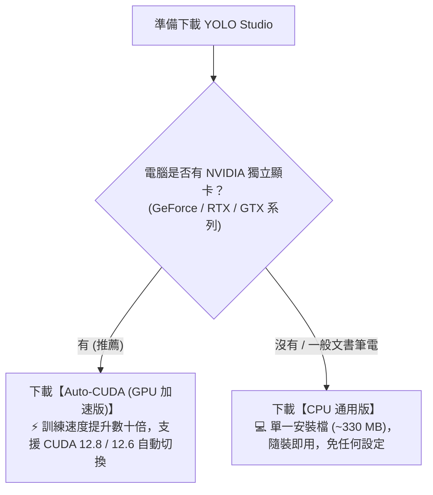
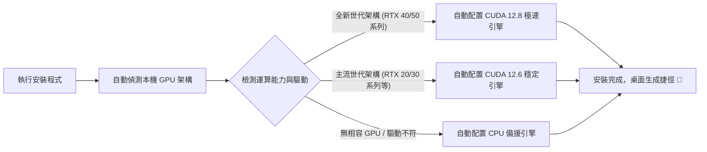

# YOLO Studio (LabelStudio) · Windows 原生視覺標註與模型訓練工作台

[](https://github.com/Jimmy-Sung/YOLOStudio)
[](https://github.com/Jimmy-Sung/YOLOStudio/releases/tag/v0.3.1)
[](https://python.org)
[](https://doc.qt.io/qtforpython/)
[](https://github.com/ultralytics/ultralytics)
[](LICENSE)

**YOLO Studio (LabelStudio)** 是一款專為 Windows 打造的輕量化、高效能 YOLO 原生桌面工作台。整合了**專案資料集管理**、**人工標註**、**AI 輔助標註**、**YOLO 模型訓練**、**測試評估指標計算**以及**模型匯出**之完整流程。

軟體基於 **Python + PySide6 / Qt 原生視窗架構**，無瀏覽器、無 Web 渲染負擔，具備極佳的介面響應速度與本機數據隱私安全性。

---

## 📥 軟體下載與安裝圖文指南 (Download & Installation)

> 🔗 **官方最新版本下載入口**：
> 👉 **[GitHub Releases 下載頁面 (v0.3.1)](https://github.com/Jimmy-Sung/YOLOStudio/releases/tag/v0.3.1)**
> （或查看歷史發布版本：[All Releases](https://github.com/Jimmy-Sung/YOLOStudio/releases)）

---

### 1. 該選哪一個版本？（版本選擇導引）



| 版本類型 | 檔案大小 | 適用環境 | 特點與說明 |
| :--- | :--- | :--- | :--- |
| **🚀 Auto-CUDA (GPU 加速版)** | 約 5.5 GB<br>（分片壓縮） | 配備 NVIDIA 顯卡之 Windows 電腦 | 內建 CUDA 12.6 與 12.8 雙離線加速深度學習引擎。安裝時會自動偵測顯卡架構分發最速引擎；無相容 GPU 時自動平滑降級為 CPU。 |
| **💻 CPU 通用版** | 約 333 MB<br>（單一檔案） | 一般辦公筆電、無獨立顯卡之電腦 | 單一安裝檔隨裝即用，免安裝 Python、免設定 CUDA 環境，適合輕量數據標註與基本驗證。 |

---

### 2. 🚀 GPU (Auto-CUDA) 版詳細安裝教學

由於 GPU 加速版包含完整的 PyTorch 與 CUDA 12.6 / 12.8 離線深度學習引擎（高達 5.5 GB），而 GitHub 單一檔案上限為 2 GB，因此安裝包採用了標準的多磁碟分片（Disk Spanning）封裝。

#### 步驟一：下載全部 5 個安裝檔
請前往 [Releases 頁面](https://github.com/Jimmy-Sung/YOLOStudio/releases/tag/v0.3.1) 的 **Assets** 區塊，下載以下 **全部 5 個檔案**：
1. `YOLO-Studio-0.3.1-Windows-x64-AutoCUDA-Setup.exe` （主安裝引導程式，約 6.8 MB）
2. `YOLO-Studio-0.3.1-Windows-x64-AutoCUDA-Setup-1.bin` （分片 1，約 1.55 GB）
3. `YOLO-Studio-0.3.1-Windows-x64-AutoCUDA-Setup-2.bin` （分片 2，約 1.56 GB）
4. `YOLO-Studio-0.3.1-Windows-x64-AutoCUDA-Setup-3.bin` （分片 3，約 1.56 GB）
5. `YOLO-Studio-0.3.1-Windows-x64-AutoCUDA-Setup-4.bin` （分片 4，約 804 MB）

*(註：附帶的 `.sha256` 檔案為完整性驗證碼，非安裝必要，可自由選擇是否下載)*

#### 步驟二：確認 5 個檔案放置於【同一個資料夾】
> ⚠️ **關鍵步驟**：下載完成後，請務必確認這 5 個檔案都在**相同的目錄（例如「下載」資料夾或自訂資料夾）**中，如下圖所示：

```text
📁 下載目錄（例如：D:\YOLOStudio_Download\）
 ├── 🚀 YOLO-Studio-0.3.1-Windows-x64-AutoCUDA-Setup.exe   <=== 【雙擊執行此安裝檔】
 ├── 📦 YOLO-Studio-0.3.1-Windows-x64-AutoCUDA-Setup-1.bin  (分片數據)
 ├── 📦 YOLO-Studio-0.3.1-Windows-x64-AutoCUDA-Setup-2.bin  (分片數據)
 ├── 📦 YOLO-Studio-0.3.1-Windows-x64-AutoCUDA-Setup-3.bin  (分片數據)
 └── 📦 YOLO-Studio-0.3.1-Windows-x64-AutoCUDA-Setup-4.bin  (分片數據)
```

#### 步驟三：雙擊執行 `.exe` 啟動安裝精靈
- 直接雙擊 **`YOLO-Studio-0.3.1-Windows-x64-AutoCUDA-Setup.exe`**。
- 安裝精靈會**自動讀取同目錄下的 4 個 `.bin` 分片**進行解壓縮，您完全不需要手動解開 `.bin` 檔案。
- 依照畫面提示點擊「下一步」完成安裝。

#### 步驟四：安裝程式幕後運作原理（自動硬體分發）
安裝過程中，內建的硬體檢測程式會自動檢測您的電腦：

- **免手動安裝 CUDA Toolkit**：安裝包已自帶完整相容庫。
- **免設定環境變數**：不污染系統既有 Python 或 CUDA PATH。
- **隨開即訓**：安裝完成後直接從桌面捷徑開啟即可在 GPU 上全速訓練！

---

### 3. 💻 CPU 通用版安裝教學

若您的電腦無 NVIDIA 顯示卡，或僅需進行圖片標註與輕量測試：
1. 至 [Releases 頁面](https://github.com/Jimmy-Sung/YOLOStudio/releases/tag/v0.3.1) 下載單一檔案：
   - `YOLO-Studio-0.3.1-Windows-x64-CPU-Setup.exe`（約 333 MB）
2. 下載後直接雙擊執行安裝即可，隨裝隨用！

---

### 4. 常見問題解答 (FAQ)

- **Q1：點擊 `.bin` 檔案提示「無法開啟此檔案」怎麼辦？**
  - **A**：`.bin` 檔案是安裝包的資料壓縮分片，**請勿直接點擊開啟它**。只要把它們跟 `Setup.exe` 放在同一個資料夾，直接雙擊執行 `Setup.exe`，安裝精靈就會自動讀取它們。
- **Q2：安裝時提示缺少 `.bin` 檔案？**
  - **A**：請檢查是否 4 個 `.bin` 檔案（`Setup-1.bin` ～ `Setup-4.bin`）皆已下載完畢，且檔案名稱沒有被瀏覽器重新命名（例如尾端多了 `(1)`）。
- **Q3：需要先安裝 Python 或 PyTorch 嗎？**
  - **A**：完全不需要。本安裝包已內建獨立隔離的執行環境，電腦無需預裝任何依賴套件。

---

## 核心功能特色

- 🎯 **流暢的人工標註體驗**
  - 原生 Qt 畫布，支援高解析度大圖平移、快速縮放、十字準星輔助線。
  - 支援快速鍵（`B` 畫框、`V` 選取/微調、`Delete` 刪框、`Ctrl+Z` 復原）。
  - 自動防呆與草稿自動保存機制，防止標註數據遺失。

- 🤖 **AI 自動候選標註與審核流程**
  - 支援載入內建預訓練模型或先前訓練出的自訂模型進行批次推論。
  - 推論結果以虛線候選框呈現，經由人工審核「確認並儲存」或「標記無目標」後方可納入訓練集，杜絕模型自我幻覺。

- ⚡ **雙模式自適應訓練（GPU 自動降級 CPU）**
  - 訓練設備預設優先使用 GPU（CUDA），無需繁瑣設定。
  - 當主機無相容 GPU 時，自動無縫降級為 CPU 訓練，流程不中斷、不跳錯誤。
  - 軟體重啟時自動清理殘留的背景訓練進程，釋放顯存並確保環境乾淨。

- 🖼️ **資料集管理與預處理工具**
  - 圖片去重、EXIF 自動旋轉校正、壞圖與破損檢測。
  - 內建影像增強與預處理（旋轉、翻轉、灰階、自動對比度、亮度調整、像素精確裁切），標註框同步連動變換。

- 📊 **嚴謹評估與一鍵匯出**
  - 每次訓練自動依比例（如 7:2:1）凍結獨立資料集快照。
  - 訓練完成自動於保留測試集計算 Precision、Recall、mAP@50、mAP@50-95 指標。
  - 支援一鍵匯出標準 YOLO 格式資料集與含有完整訓練日誌、類別定義之 `.pt` 模型套件。

---

## 原始碼本機運行 (Source Code Setup)

若您希望從原始碼執行或進行二次開發：

### 1. 取得專案原始碼
```bash
git clone https://github.com/Jimmy-Sung/YOLOStudio.git
cd YOLOStudio
```

### 2. 環境安裝 (Windows PowerShell)
```powershell
# 建立專屬虛擬環境並安裝基本依賴
powershell -ExecutionPolicy Bypass -File .\setup.ps1

# 若需要完整 YOLO 訓練與 PyTorch 引擎
powershell -ExecutionPolicy Bypass -File .\setup.ps1 -WithYolo
```

### 3. 啟動軟體
- 直接雙擊目錄下的 `YOLO Studio.exe`（原生啟動器，不開啟黑視窗）
- 或透過終端執行：
  ```powershell
  powershell -ExecutionPolicy Bypass -File .\start.ps1
  ```

---

## ⚠️ 版權與授權協議 (Academic & Non-Commercial License)

本專案之程式碼、架構設計與隨附安裝工具採用 **學術研究與非商業使用授權協議（Academic & Non-Commercial Research License）**：

1. **嚴格禁止商用**：本軟體及其任何模組、衍生物嚴禁直接或間接用於任何商業營利行為、企業生產線檢測收費服務或未經授權之商業產品集成。
2. **學術與教育開放**：允許並歡迎於個人研習、學術論文研究、學校教學與技術概念驗證中自由使用與修改。
3. **署名要求**：在學術論文、技術報告或展示中引用本專案時，請註明出處與原作者署名。
4. **免責聲明**：本軟體按「現狀」（As-Is）提供，作者不承擔因使用本軟體衍生之任何責任。

完整授權條款全文請參閱：[`LICENSE`](LICENSE)

---

## 聯絡與支援

如有問題回報或學術交流需求，歡迎至 [GitHub Issues](https://github.com/Jimmy-Sung/YOLOStudio/issues) 提出討論。
